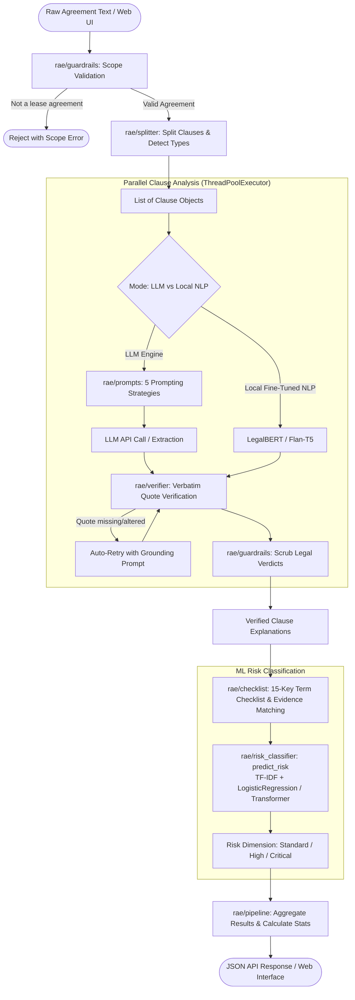

# Rental Agreement Explainer (RAE) — System Architecture & Implementation Guide

## 1. Executive Summary

The **Rental Agreement Explainer (RAE)** is an intelligent, evidence-grounded analysis engine designed for residential rental and lease agreements in India. It accepts raw lease agreement text and produces:

1. **Clause-by-Clause Plain-English Explanations:** Explains legal rights, obligations, and consequences without legal jargon.
2. **Clause Fairness Classification:** Labels clauses as **Standard**, **Unusual**, or **One-Sided** with structured justifications.
3. **Verbatim Quotation Grounding & Verification:** Every assessment must cite verbatim supporting evidence directly from the source contract text; ungrounded statements are automatically flagged.
4. **Machine Learning Risk Classification:** Clause risk severity (**Standard**, **Low**, **Medium**, **High**, **Critical**) evaluated by a local ML model (`models/risk-clf-sklearn/pipeline.pkl`) without relying on brittle regex heuristics.
5. **15-Term Reference Checklist:** Identifies missing, incomplete, or present essential lease terms (e.g., rent, deposit, lock-in, notice, maintenance, handover).
6. **Contradiction and Ambiguity Detection:** Highlights inconsistencies across disjoint sections (e.g., 11-month lease vs. 12-month lock-in).
7. **Legal Advice Guardrails:** Scrubs unauthorized legal verdicts and attaches mandatory advisory disclaimers on risky clauses.

---

## 2. High-Level Architecture & Pipeline Flow

The system operates across distinct pipeline phases orchestrated by `rae/pipeline.py`.



---

## 3. Core Modules and Subsystems

### 3.1. Clause Splitting & Type Guessing (`rae/splitter.py`)
- **Clause Splitting:** Splits agreements by numbered sections (`1.`, `Clause 2:`, roman numerals), heading boundaries (`CAPITALIZED HEADINGS:`), or paragraph double newlines.
- **Header Parsing:** Distinguishes agreement preamble/parties from enforceable covenants.
- **Type Heuristics:** Assigns provisional clause categories (e.g., `rent`, `deposit`, `lock_in`, `termination`, `maintenance`, `landlord_entry`) used for fallback context.

### 3.2. Prompt Engineering & Multi-Strategy Reasoning (`rae/prompts.py`)
The system supports 5 distinct prompt engineering strategies selectable at runtime:
1. `zero_shot`: Direct analysis instruction with required JSON schema.
2. `few_shot`: In-context learning using exemplar contract clauses and expected explanations.
3. `persona`: Evaluates provisions from the perspective of an experienced tenant-rights advocate / tenant advisor.
4. `template`: Constrained template formatting enforcing strict output syntax.
5. `cot` (Chain-of-Thought): Forces step-by-step reasoning (Rights identification -> Imbalance analysis -> Evidence extraction -> Verdict justification).

Each prompt enforces a 4-part schema:
- `clause_type`: Canonical category.
- `explanation`: Plain-language explanation (1–3 sentences).
- `label`: Fairness classification (`Standard`, `Unusual`, `One-sided`).
- `label_reason`: Why this label applies.
- `quote`: Verbatim quote from the clause supporting the finding.
- `is_incomplete`: Boolean flag for blanks like `[Amount]`, `_____`, or missing schedules.

### 3.3. Verbatim Evidence Verification (`rae/verifier.py`)
- To prevent LLM hallucinations, `verify_result()` validates that `quote` exists word-for-word in the target clause (normalized for punctuation and case).
- If absent, it checks if it appears anywhere in the full document.
- If unverified, the pipeline issues a re-grounding retry prompt. If still unverified, the clause is flagged with `needs_review: true`.

### 3.4. Guardrails & Safety (`rae/guardrails.py`)
- **Scope Checking:** Validates document relevance (`is_rental_agreement`) by checking lease keyword density and document length.
- **Verdict Scrubbing:** Sanitizes legal overreach terms (`"is illegal"`, `"void"`, `"you will win in court"`) and replaces them with advisory notes (`"[verdict removed: ask a lawyer]"`).
- **Mandatory Disclaimers:** Automatically appends legal disclaimers whenever a clause is flagged as `One-sided` or represents a high-risk category (`penalty`, `termination`, `deposit`).

### 3.5. 15-Key Term Reference Checklist (`rae/checklist.py`)
Lease agreements often omit critical tenant protections. The checklist evaluates 15 canonical key terms:
1. `rent` (amount, due date)
2. `deposit` (amount, deductions, refund timeline)
3. `lock_in` (minimum tenancy term)
4. `notice_period` (prior written notice requirements)
5. `termination` (conditions and breach remedies)
6. `rent_increase` (escalation percentage and advance notice)
7. `maintenance` (structural vs. routine repair obligations)
8. `landlord_entry` (prior notice and inspection conditions)
9. `subletting` (prohibitions or permission rules)
10. `utilities` (electricity, water, maintenance dues)
11. `dispute_resolution` (arbitration, court jurisdiction)
12. `police_verification` (distinguishes ID collection from formal station verification)
13. `registration` (stamp duty, promise vs. proof of registration)
14. `tenancy_period` (start date, tenure duration)
15. `handover` (possession delivery and return condition)

Each item outputs 4 independent dimensions:
- `presence`: `Present` vs. `Missing`.
- `completeness`: `Complete` vs. `Incomplete` (detects placeholders like `_____`).
- `legal_compliance`: `Compliant` vs. `Requires Review`.
- `risk_level`: Evaluated dynamically by the ML model.

### 3.6. Machine Learning Risk Model (`rae/risk_classifier.py`)
To prevent hand-crafted rules from misclassifying nuanced legal language, risk classification is driven by a machine learning model:
- **Model:** `models/risk-clf-sklearn/pipeline.pkl` (TF-IDF Vectorizer + Balanced Logistic Regression).
- **Training Harness:** `rae/train_risk_classifier_sklearn.py`.
- **Training Dataset:** `data/risk_training.csv` (labeled samples of `Standard`, `High`, and `Critical` clauses).
- **Inference Function:** `predict_risk(clause_text: str) -> str`.
- **Transformer Alternative:** `rae/train_risk_model.py` provides an offline Seq2Seq fine-tuning harness for Flan-T5 / Gemma when running on GPU environments.

---

## 4. Benchmark & Evaluation Suite (`benchmark/`)

The repository includes an empirical evaluation framework:
- `benchmark.json`: Ground truth gold dataset containing real and synthetic Indian rental agreements.
- `run_benchmark.py`: Evaluates strategy accuracy, quote faithfulness, and label distribution across `few_shot`, `zero_shot`, `cot`, etc.
- `sensitivity.py`: Tests model robustness against paraphrased clauses.
- `rubric.md`: Scoring rubric for qualitative grading of explanations.

---

## 5. Directory Structure & Key Files

```
├── app.py                             # Flask web app and API (/api/analyze)
├── requirements.txt                   # Project dependencies
├── templates/
│   └── index.html                     # Web UI for agreement analysis & checklist view
├── rae/                               # Core analysis package
│   ├── pipeline.py                    # End-to-end analysis orchestration
│   ├── checklist.py                   # 15-key term checklist & evidence matcher
│   ├── risk_classifier.py             # ML model loader & risk predictor
│   ├── train_risk_classifier_sklearn.py # Model training script (scikit-learn)
│   ├── train_risk_model.py            # Model training script (Transformer Seq2Seq)
│   ├── splitter.py                    # Clause chunking and regex type guessing
│   ├── prompts.py                     # Prompt generation & 5 reasoning strategies
│   ├── llm.py                         # LLM connector with offline mock mode
│   ├── verifier.py                    # Verbatim quote verification engine
│   ├── guardrails.py                  # Domain scope and legal disclaimer checks
│   └── nlp/                           # Local model inference (LegalBERT & Flan-T5)
├── models/
│   ├── risk-clf-sklearn/pipeline.pkl  # Trained ML risk classifier
│   ├── legalbert_classifier/          # Fine-tuned LegalBERT model
│   └── flant5_explainer/              # Fine-tuned Flan-T5 explanation generator
├── data/
│   └── risk_training.csv              # Ground-truth training clauses for risk model
├── tests/
│   ├── test_checklist.py              # Tests for checklist, evidence, and risk
│   ├── test_core.py                   # Unit tests for pipeline and splitter
│   └── test_nlp.py                    # Local NLP and model tests
└── benchmark/                         # Evaluation, sensitivity, and gold datasets
```

---

## 6. How to Run and Maintain the System

### Running the Web Application
```bash
# Optional: export ANTHROPIC_API_KEY="..." or set RAE_MOCK=1 for offline testing
python3 app.py
# Access Web UI at http://localhost:5000
```

### Running Test Verification
```bash
pytest -q
```

### Retraining the ML Risk Model
When adding new edge cases or contract clauses:
1. Append new examples with labels (`Standard`, `High`, `Critical`) into `data/risk_training.csv`.
2. Run the training script:
```bash
python3 -m rae.train_risk_classifier_sklearn --train-path ./data/risk_training.csv --output-dir ./models/risk-clf-sklearn
```
3. Run tests to confirm regression safety:
```bash
pytest -q
```
